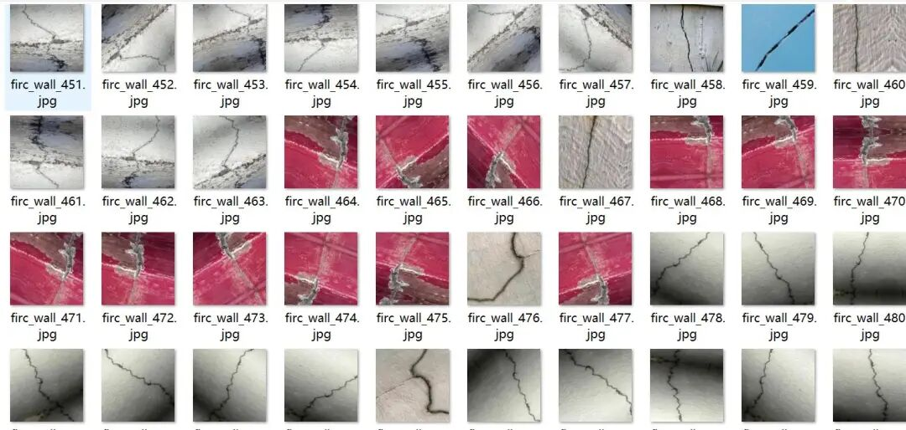
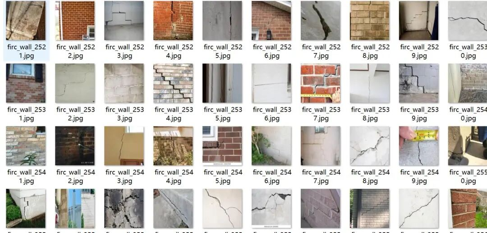
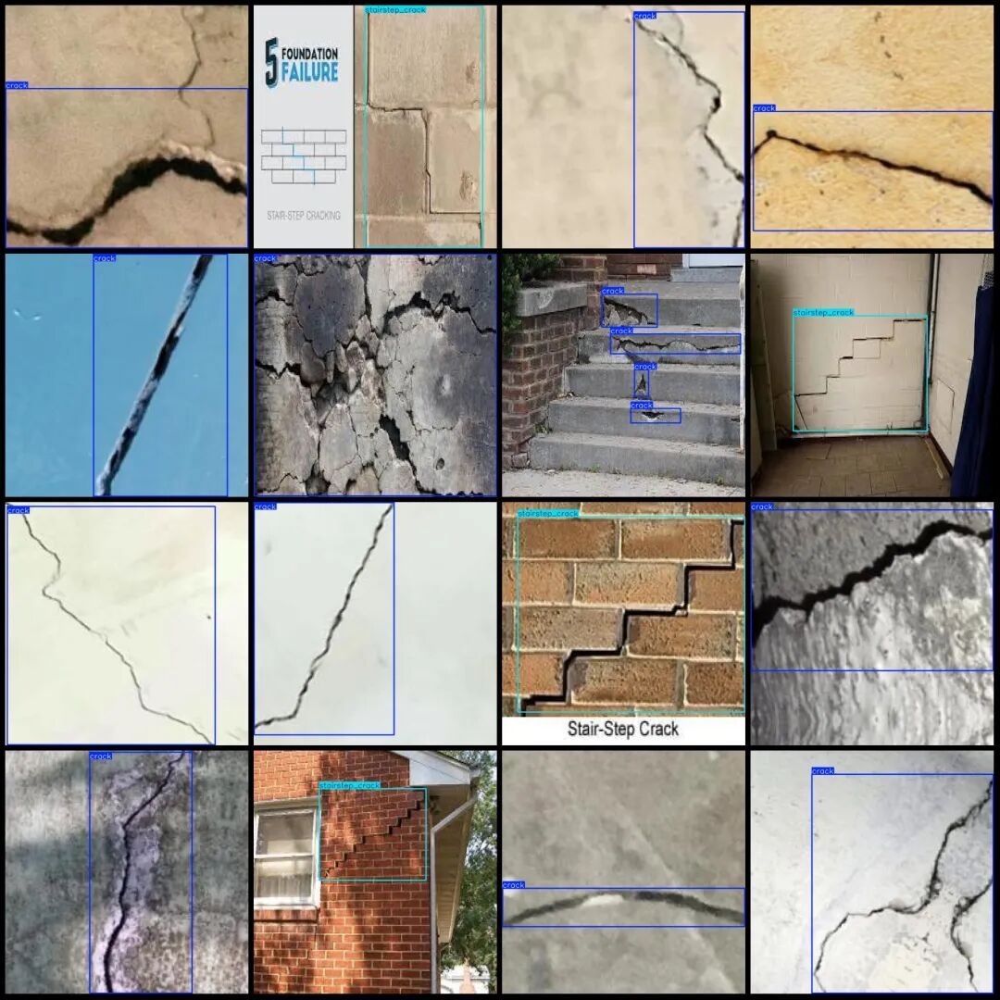
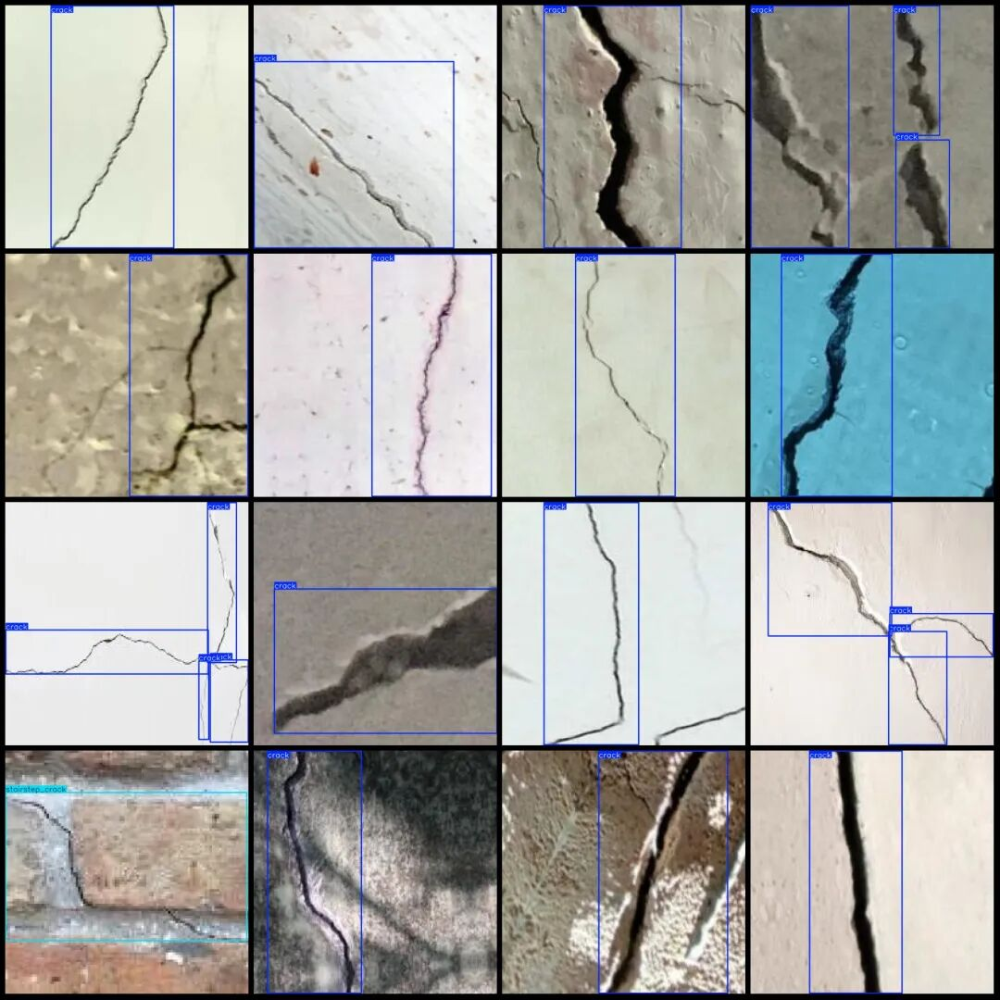

# Building Wall Wall Cracks Mold Water Infiltration and Paint Delamination Detection Data Set in VOC+YOLO format with 2920 images across 5 categories

Dataset format: Pascal VOC format + YOLO format (txt file without split path, only containing jpg images and corresponding VOC format xml files and yolo format txt files)

Number of images (number of jpg files): 2920

Number of annotations (number of xml files): 2920

Number of annotations (number of txt files): 2920

Label category count: 5

Label category names (Note that the order of yolo format categories does not correspond to this, but is based on the labels folder's classes.txt): ["crack", "mold", "peeling_paint", "stairstep_crack", "water_seepage"]

Number of boxes labeled in each category:

Crack (cracks) Frames = 2773

Mold (mold) frame count = 134

Peeling paint (paint peeling) frame count = 306

stairstep_crack (Step-like crack) Frames = 311

Water seepage (seepage) frame count = 149

Total frame count: 3673

Image resolution: 640x640

Using labelImg:

Annotation rules: Draw a rectangle around the category.

Important Notice: No

Special : This dataset does not guarantee the accuracy of the trained models or weight files.

Image Preview:

Annotation example:

## Payment

Here is a pay link on Stripe ( https://buy.stripe.com/3cs8yP7sY87d0vu9AB ). Please contact me lonlonago@foxmail.com after funding $89, and I will send you a complete data files , thank you!

